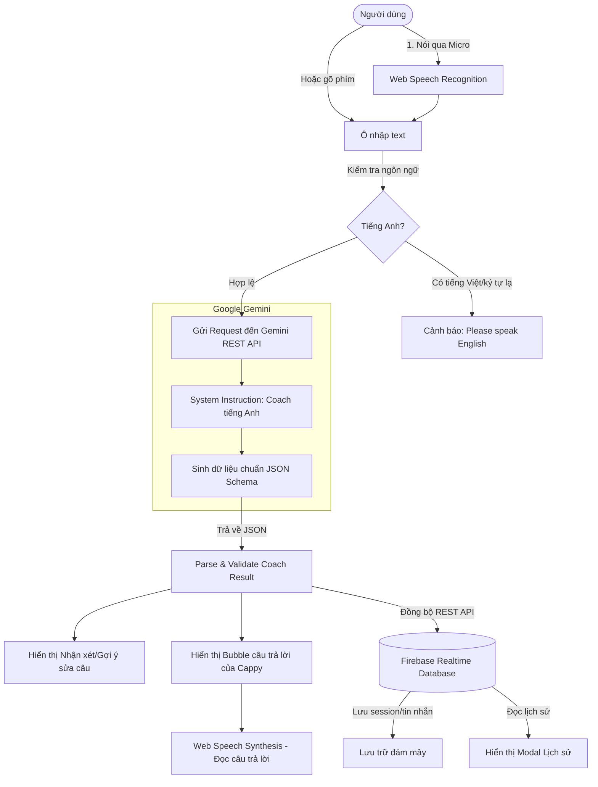

# English Cappy AI — Tài liệu Chi tiết Dự án (englishcappy.md)

Tài liệu này tổng hợp toàn bộ thông tin kiến trúc, công nghệ, luồng xử lý và dữ liệu của dự án **English Cappy AI** để bất kỳ lập trình viên hoặc AI Agent nào khi đọc qua cũng hiểu rõ dự án và có thể tiếp tục phát triển hoặc bảo trì một cách nhanh chóng.

---

## 1. Tổng quan Dự án (Project Overview)

- **Tên dự án**: English Cappy AI (Luyện nói và sửa câu tiếng Anh).
- **Mục tiêu**: Cung cấp ứng dụng web trực tiếp trên trình duyệt giúp người học tiếng Anh (đặc biệt là người mới bắt đầu) có thể luyện tập phản xạ giao tiếp, nói hoặc gõ câu tiếng Anh, được AI chỉnh sửa ngữ pháp/cách diễn đạt tự nhiên bằng tiếng Việt, phản hồi câu thoại tiếp nối cuộc hội thoại, và tự động lưu trữ toàn bộ lịch sử trò chuyện lên đám mây.
- **Mô hình hoạt động**: Single Page Application (SPA) đóng gói gọn gàng trong 1 file HTML duy nhất (`English_gemini_ai.html`), không cần build-step phức tạp hay backend riêng (Serverless hoàn toàn qua REST API của Gemini và Firebase).

---

## 2. Công nghệ Sử dụng (Tech Stack)

| Thành phần | Công nghệ / Dịch vụ | Chi tiết triển khai |
| :--- | :--- | :--- |
| **Giao diện & Logic** | HTML5, CSS3, JavaScript (ES6+) | Giao diện hiện đại, tối giản, responsive cho mobile và desktop |
| **Thư viện DOM** | jQuery 3.7.1 | Được nhúng inline trực tiếp trong file HTML để chạy offline/không phụ thuộc CDN bên ngoài |
| **AI Engine** | Google Gemini API (`gemini-3.5-flash-lite`) | Gọi qua REST API `generateContent`, cấu hình Structured Outputs (JSON Schema) và System Instruction |
| **Speech-to-Text (STT)** | Web Speech Recognition API (`webkitSpeechRecognition`) | Nhận diện giọng nói tiếng Anh (`en-US`) trực tiếp trên trình duyệt Chrome/Edge/Safari |
| **Text-to-Speech (TTS)** | Web Speech Synthesis API (`SpeechSynthesisUtterance`) | Đọc to câu trả lời của AI và câu mẫu gợi ý với giọng chuẩn `en-US` |
| **Cơ sở dữ liệu (Database)** | Firebase Realtime Database | Lưu trữ lịch sử các phiên trò chuyện (sessions) qua REST API (không cần cài Firebase SDK) |

---

## 3. Cấu trúc File & Kiến trúc Hệ thống

### 3.1 Cấu trúc thư mục
```text
e:\TTDN\
├── English_gemini_ai.html   # Mã nguồn chính (HTML + CSS + jQuery + Logic ứng dụng)
└── englishcappy.md          # Tài liệu mô tả dự án (File này)
```

### 3.2 Luồng dữ liệu (Architecture Workflow)



---

## 4. Chi tiết các Chức năng Cốt lõi

### 4.1. Nhận diện giọng nói (Speech-to-Text)
- Sử dụng `window.SpeechRecognition` hoặc `window.webkitSpeechRecognition`.
- Thiết lập ngôn ngữ: `recognition.lang = 'en-US'`.
- Tự động điền văn bản nhận dạng vào ô nhập liệu (`#message`).
- Tích hợp tính năng an toàn: Nếu bấm nút "Gửi" khi micro đang hoạt động, hệ thống sẽ đợi nhận dạng hoàn tất (`waitingToSend = true`) rồi mới gửi tới Gemini.

### 4.2. Bộ lọc ngôn ngữ đầu vào (Language Validation)
- Regex kiểm tra tiếng Việt và các bảng mã không phải tiếng Anh:
  ```javascript
  const NON_ENGLISH_REGEX = /[àáảãạăắằẳẵặâấầẩẫậđèéẻẽẹêếềểễệìíỉĩịòóỏõọôốồổỗộơớờởỡợùúủũụưứừửữựỳýỷỹỵ\u0400-\u04FF\u4E00-\u9FFF\u3040-\u30FF\uAC00-\uD7AF\u0600-\u06FF]/i;
  ```
- Nếu phát hiện người dùng nói/gõ tiếng Việt, ứng dụng lập tức từ chối và phát âm thanh: *"I don't understand, please speak English."* để rèn luyện thói quen 100% tiếng Anh.

### 4.3. Huấn luyện viên AI & Giao tiếp cùng Gemini API
- **Model sử dụng**: `gemini-3.5-flash-lite` (nhanh, nhẹ, chi phí thấp hoặc nằm trong Free Tier).
- **Endpoint**:
  `https://generativelanguage.googleapis.com/v1beta/models/gemini-3.5-flash-lite:generateContent?key=...`
- **System Instruction**:
  - Đóng vai bạn học kiêm gia sư kiên nhẫn cho người mới học.
  - Phân loại câu người dùng thành 4 mức (`assessment`):
    - `correct`: Câu đúng và tự nhiên.
    - `naturalness`: Ngữ pháp tạm ổn nhưng cách dùng từ chưa tự nhiên.
    - `correction`: Sai ngữ pháp hoặc dùng từ sai nghĩa.
    - `not_english`: Không phải tiếng Anh.
  - Bỏ qua các lỗi về dấu câu hoặc viết hoa (do chuyển từ giọng nói).
  - Không tự nhận xét phát âm khi chỉ nhìn văn bản.
  - Cung cấp câu gợi ý hoàn chỉnh (`suggested`) kèm lời giải thích ngắn gọn bằng tiếng Việt (`explanationVi`).
  - Phản hồi câu giao tiếp tiếp nối ngắn gọn (`reply`), kèm bản dịch tiếng Việt chuẩn (`replyVi`).

### 4.4. Cấu trúc JSON Schema (Structured Output)
Gemini trả về chính xác JSON schema:
```json
{
  "assessment": "correction | naturalness | correct | not_english",
  "suggested": "Câu tiếng Anh đã sửa hoàn chỉnh (hoặc rỗng nếu đã đúng)",
  "explanationVi": "Giải thích ngắn bằng tiếng Việt về lỗi hoặc cách diễn đạt",
  "reply": "Câu trả lời tiếng Anh tự nhiên để tiếp tục hội thoại",
  "replyVi": "Bản dịch tiếng Việt của câu reply"
}
```

### 4.5. Phát âm âm thanh (Text-to-Speech)
- Sử dụng Web Speech Synthesis để tự động phát âm câu trả lời của AI ngay khi có phản hồi.
- Cho phép người dùng bấm nút **🔊 Nghe lại** để nghe lại câu trả lời bất kỳ lúc nào.
- Có nút **🔊 Nghe câu gợi ý** riêng biệt trong khung nhận xét để nghe phát âm câu tiếng Anh đúng.
- Tự động ưu tiên chọn voice tiếng Anh chuẩn (`en-US` hoặc voice bắt đầu bằng `en`).

### 4.6. Dịch tức thì sang tiếng Việt (Translation Feature)
- Mỗi tin nhắn của bot đều đi kèm nút **🌐 Dịch tiếng Việt / ✕ Ẩn dịch**.
- Nếu có sẵn trường `replyVi` từ Gemini, hiển thị ngay không tốn thêm request.
- Nếu chưa có sẵn, hệ thống tự động gọi hàm fallback `translateText()` gửi prompt dịch độc lập sang Gemini.

### 4.7. Lưu trữ Lịch sử trên Firebase Realtime Database
- **URL cơ sở**: `https://englishtalk-17f02-default-rtdb.asia-southeast1.firebasedatabase.app`
- Giao tiếp hoàn toàn qua REST API HTTP:
  - **Tải tất cả phiên chat**: `GET /sessions.json`
  - **Lưu/Cập nhật phiên hiện tại**: `PUT /sessions/{sessionId}.json`
  - **Xóa 1 phiên chat**: `DELETE /sessions/{sessionId}.json`
  - **Xóa toàn bộ lịch sử**: `DELETE /sessions.json`
- **Cấu trúc 1 Session trong Firebase**:
  ```json
  {
    "id": "session_1717654321000",
    "title": "Tiêu đề (lấy từ 40 ký tự đầu của câu nói đầu tiên)",
    "createdAt": 1717654321000,
    "updatedAt": 1717654350000,
    "dateStr": "06/11/2026 08:30",
    "messages": [
      {
        "role": "user",
        "text": "Hello, how are you today?",
        "timestamp": 1717654321000
      },
      {
        "role": "bot",
        "text": "I'm doing well, thank you! How is your day going?",
        "replyVi": "Tôi khỏe, cảm ơn bạn! Ngày của bạn thế nào?",
        "feedback": {
          "assessment": "correct",
          "suggested": "",
          "explanationVi": "",
          "reply": "I'm doing well, thank you! How is your day going?",
          "replyVi": "Tôi khỏe, cảm ơn bạn! Ngày của bạn thế nào?"
        },
        "timestamp": 1717654323000
      }
    ]
  }
  ```

### 4.8. Quản lý Gemini API Key
- Có sẵn API Key mặc định được mã hóa Base64 (`DEFAULT_API_KEY`), giải mã tự động bằng `atob()`.
- Ô nhập API Key cho phép người dùng tùy chỉnh:
  - Ẩn/Hiện key (`type="password"` hoặc `text`).
  - Nút **Mặc định** để khôi phục key ban đầu.
  - Tự động kiểm tra trạng thái kết nối (`checkGeminiConnection`) qua endpoint `/models/{MODEL}` và hiển thị badge:
    - `Đang kiểm tra kết nối…` (màu vàng)
    - `✓ Đã kết nối Gemini` (màu xanh lá)
    - `✗ Lỗi kết nối / Không có key` (màu đỏ)
  - Thông báo rõ ràng mã lỗi nếu có (400, 401, 403, 404, 429, 500).

---

## 5. Hướng dẫn Chạy & Kiểm thử

1. **Khởi chạy ứng dụng**:
   - Mở trực tiếp file `English_gemini_ai.html` bằng trình duyệt hiện đại (Google Chrome, Microsoft Edge, Brave,...).
   - **Lưu ý**: Để tính năng Microphone (Web Speech Recognition) hoạt động trơn tru, khuyến nghị chạy qua một máy chủ tĩnh cục bộ (Local Server) như `npx serve .` hoặc tiện ích *Live Server* trong VS Code / IDE (địa chỉ `http://localhost:...`).
2. **Quyền truy cập micro**:
   - Khi nhấn nút **🎙️ Nói**, trình duyệt sẽ yêu cầu cấp quyền Micro. Chọn **Cho phép** (Allow).
3. **Thao tác mẫu**:
   - Thử nói: *"Yesterday I go to market."*
   - Cappy sẽ nhận xét: Gợi ý sửa thành *"Yesterday I went to the market."* và giải thích cách chia thì quá khứ đơn, đồng thời hỏi câu tiếp theo: *"What did you buy there?"*.
   - Nhấn **📜 Lịch sử** ở góc trên để xem phiên chat vừa được tự động đồng bộ lên Firebase.

---

## 6. Gợi ý Hướng Phát triển Tiếp theo (Future Roadmap)

1. **Chấm điểm phát âm thực tế**:
   - Tích hợp Gemini Audio Multimodal (Live API) hoặc Gemini 1.5/2.0 Flash Audio để gửi file âm thanh WAV/MP3 trực tiếp lên AI thay vì chỉ gửi text từ STT.
2. **Chế độ theo chủ đề (Topics & Scenarios)**:
   - Thêm dropdown chọn chủ đề: Đặt món nhà hàng, phỏng vấn xin việc, du lịch sân bay, đi khám bệnh,...
3. **Thống kê tiến trình học (Analytics & Streak)**:
   - Đếm số câu nói mỗi ngày, số ngày luyện liên tục (streak), và tổng hợp các lỗi ngữ pháp thường gặp nhất dựa trên dữ liệu từ Firebase.
4. **Bảo mật cơ sở dữ liệu**:
   - Hiện Firebase Realtime Database đang mở chế độ Read/Write công khai qua REST URL; trong tương lai có thể cấu hình Firebase Authentication (đăng nhập Google) và Firebase Security Rules để bảo vệ dữ liệu người dùng riêng biệt.

